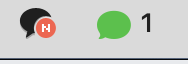

# ChatLamp

Google Chat에 안 읽은 메시지가 있으면 맥 메뉴 막대 아이콘에 불이 들어옵니다. 카카오톡 메뉴 막대 아이콘처럼 동작합니다.



| 메뉴 막대 아이콘 | 뜻 |
| --- | --- |
| 초록 말풍선 + 숫자 | 안 읽은 메시지 있음. 숫자는 Google Chat이 보여 주는 개수 |
| 테두리만 있는 말풍선 | 안 읽은 메시지 없음 |
| 흐린 말풍선 | 크롬이 꺼져 있거나, Google Chat이 열려 있지 않거나, 확장이 연결되지 않음 |

아이콘을 누르면 지금 상태, **Google Chat 열기**, **아이콘 옆에 개수 표시**, **로그인 시 열기** 메뉴가 나옵니다.

> Google과 관계없는 개인 프로젝트입니다. Google Chat은 Google LLC의 상표입니다.

## 구성

크롬 확장만으로는 맥 메뉴 막대에 아이콘을 띄울 수 없어서 두 부분으로 나뉩니다.

```
Google Chat 탭(또는 크롬 앱 창)
  └ 크롬 확장 ── 안 읽은 메시지가 있는지 읽는다
       │  크롬 네이티브 메시징 (확장이 맥 프로그램과 직접 주고받는 크롬 공식 방법)
       ▼
  chatlamp-host ── 크롬이 실행하는 작은 프로그램. 받은 상태를 그대로 앱에 넘긴다
       │  macOS 분산 알림
       ▼
  ChatLamp.app ── 메뉴 막대 아이콘을 켜고 끈다
```

- `extension/` 크롬 확장 (Manifest V3)
- `app/` 메뉴 막대 앱과 chatlamp-host (Swift, Xcode 없이 빌드)

## 설치

macOS 13 이상, 크롬(또는 Edge·Brave 같은 크롬 계열 브라우저)이 필요합니다.

### 1. 앱 빌드와 실행

Xcode Command Line Tools가 있으면 됩니다 (`xcode-select --install`).

```bash
git clone https://github.com/cacaocoffee/mac-google-chat.git
cd mac-google-chat
./build.sh
cp -R build/ChatLamp.app /Applications/
open /Applications/ChatLamp.app
```

처음 실행하면 앱이 두 가지를 합니다.

- 크롬이 chatlamp-host를 찾을 수 있도록 `~/Library/Application Support/Google/Chrome/NativeMessagingHosts/`에 등록 파일을 씁니다. 앱을 다른 폴더로 옮겼다면 한 번 다시 실행하세요.
- 로그인 항목에 자기를 넣습니다. 원하지 않으면 메뉴에서 **로그인 시 열기**를 끄세요.

### 2. 확장 설치

1. 크롬 주소창에 `chrome://extensions`를 입력합니다.
2. 오른쪽 위 **개발자 모드**를 켭니다.
3. **압축해제된 확장 프로그램을 로드합니다**를 누르고 저장소의 `extension` 폴더를 고릅니다.
4. 열려 있던 Google Chat 창을 ⌘R로 새로고침합니다.

**Google Chat을 크롬 앱(설치한 웹 앱)으로 쓴다면, 그 앱이 설치된 크롬 프로필에 확장을 넣어야 합니다.** 다른 프로필에 넣으면 확장이 Google Chat 창을 보지 못해서, 확장 상태 창에 「Google Chat이 열려 있지 않음」이 나옵니다.

### Google Chat 앱 없이 크롬 탭으로 쓸 때

크롬 앱을 설치하지 않아도 됩니다. 확장은 일반 탭에 열린 `chat.google.com`도 똑같이 읽습니다. 다만 카카오톡처럼 혼자 실행되는 앱이 아니어서, 크롬이 켜져 있고 Google Chat 탭이 어딘가에 열려 있어야 불이 들어옵니다. 탭이 뒤에 가려져 있는 것은 괜찮습니다.

크롬의 메모리 절약 기능이 오래 안 본 탭을 비활성화하면 확장이 그 탭을 읽을 수 없습니다. `chrome://settings/performance`에서 `chat.google.com`을 항상 활성 상태로 둘 사이트로 추가해 두세요.

## 안 될 때

크롬 툴바에서 ChatLamp 확장 아이콘을 누르면 상태 창이 열립니다.

| 상태 창에 나오는 것 | 할 일 |
| --- | --- |
| 메뉴 막대 앱: 연결 안 됨 · 「ChatLamp 앱을 한 번 실행해 주세요」 | 앱을 실행합니다. 앱이 처음 실행될 때 크롬에 등록 파일을 씁니다 |
| 「ChatLamp 앱이 꺼져 있습니다」 | 응용 프로그램 폴더에서 ChatLamp를 실행합니다 |
| 지금 상태: Google Chat이 열려 있지 않음 | Google Chat 창을 새로고침합니다. 그래도 같으면 확장이 Google Chat과 다른 프로필에 들어가 있는지 봅니다 |
| 지금 상태: 새 메시지가 있는지 알 수 없음 | 아래 **탭별 판단 근거**를 펼쳐 네 신호가 모두 「알 수 없음」인지 봅니다. Google Chat 화면 구조가 바뀐 것일 수 있으니 이슈로 알려 주세요 |

## 안 읽은 메시지를 알아내는 방법

확장은 Google Chat 화면에서 네 가지를 읽고, 아래 순서대로 먼저 답을 주는 것을 따릅니다.

1. **파비콘**: 안 읽은 것이 있으면 Google Chat이 파비콘을 점이 찍힌 그림(`…_dot_64px.png`)으로 바꿉니다. 창이 가려져 있어도 바뀌므로 가장 먼저 봅니다.
2. **Dock 배지**: 크롬 앱으로 열었을 때 Google Chat이 Dock 아이콘에 다는 숫자입니다. 페이지가 배지를 다는 함수(`navigator.setAppBadge`)를 부를 때 그 값을 함께 받습니다. Dock 배지는 전과 똑같이 달립니다.
3. **왼쪽 목록 숫자**: 「채팅」「스페이스」 묶음 머리에 적힌 숫자를 더합니다.
4. **탭 제목**: 제목에 `Chat (3)`처럼 숫자가 있으면 읽습니다.

메뉴 막대 옆 숫자는 Dock 배지 → 왼쪽 목록 → 탭 제목 순서로 처음 나오는 양수입니다.

Google이 화면 구조를 바꾸면 감지가 틀릴 수 있습니다. 감지 규칙은 [`extension/content/detect.js`](extension/content/detect.js) 한 파일에 모여 있습니다. 화면 구조는 [ankurk91/google-chat-tauri](https://github.com/ankurk91/google-chat-tauri)가 2026년 9월에 확인해 정리한 내용을 참고했습니다. 코드는 가져오지 않았습니다.

확장은 안 읽은 메시지가 있는지와 그 개수만 읽습니다. 메시지 내용, 대화 상대, 대화방 이름은 읽지도 보내지도 않습니다.

## 제거

1. 메뉴에서 **로그인 시 열기**를 끄고 **ChatLamp 종료**를 누릅니다.
2. `/Applications/ChatLamp.app`을 지웁니다.
3. `chrome://extensions`에서 ChatLamp를 삭제합니다.
4. 크롬 등록 파일을 지웁니다.
   ```bash
   rm ~/Library/Application\ Support/*/*/NativeMessagingHosts/io.github.cacaocoffee.chatlamp.json \
      ~/Library/Application\ Support/*/NativeMessagingHosts/io.github.cacaocoffee.chatlamp.json 2>/dev/null
   ```

## 개발

```bash
./build.sh                          # 이 맥의 CPU용으로 build/ChatLamp.app 생성
ARCHS="arm64 x86_64" ./build.sh zip # 애플 실리콘·인텔 겸용 + build/ChatLamp.zip
node --test test/detect.test.js     # 감지 규칙 테스트
swift scripts/make-icons.swift      # 아이콘 다시 그리기
```

- 확장 ID는 `extension/manifest.json`의 `key`로 `hieanablcjkmeeohhplglfaegdagigmk`에 고정돼 있습니다. 앱은 이 ID의 확장에만 연결을 허락합니다(`app/Shared/Bridge.swift`).
- 앱 기록 보기: `/usr/bin/log stream --level info --predicate 'subsystem == "io.github.cacaocoffee.chatlamp"'`

## 라이선스

[MIT](LICENSE)
